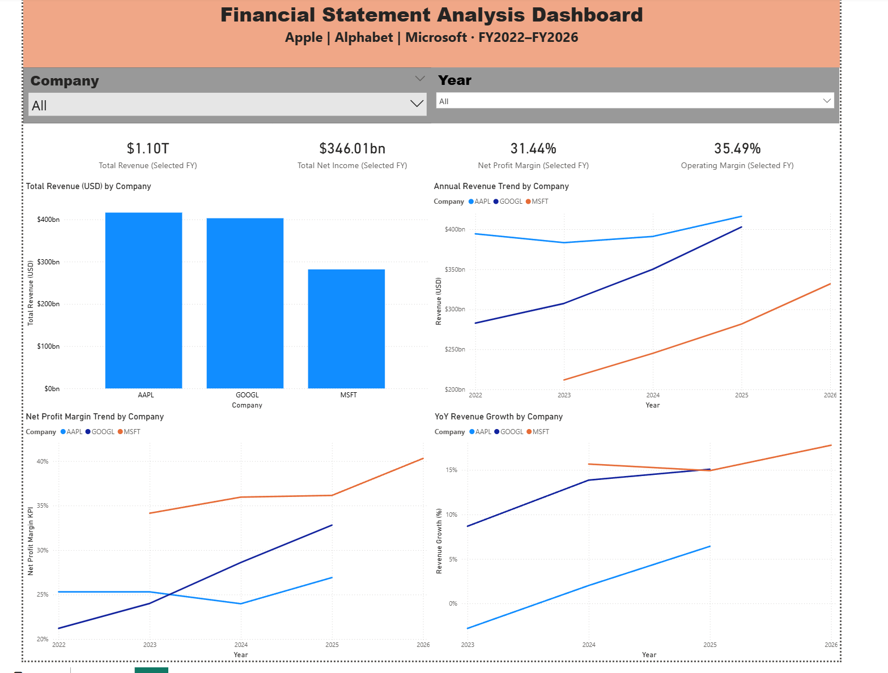

# Financial Statement Analysis Dashboard

An end-to-end financial data analysis project comparing the financial performance of **Apple, Alphabet, and Microsoft** from FY2022–FY2026.

The project uses **Python and pandas** for financial data extraction and transformation, **Google Cloud Storage** for cloud file storage, **BigQuery** for cloud-based SQL analytics, and **Power BI** for interactive visualization.

## Dashboard



## Architecture

Python → Google Cloud Storage → BigQuery → Power BI

### Data Pipeline

1. Financial statement data is extracted using Python and `yfinance`.
2. The data is cleaned and transformed using `pandas`.
3. Financial metrics such as gross margin, operating margin, and net profit margin are calculated.
4. The cleaned dataset is exported as a CSV file.
5. The CSV is uploaded to Google Cloud Storage.
6. BigQuery loads the CSV into a native table for SQL querying and analytics.
7. Power BI connects to BigQuery and visualizes the financial data.

## Technologies Used

- Python
- pandas
- yfinance
- Google Cloud Storage
- Google BigQuery
- SQL
- Power BI
- DAX
- Power Query

## Financial Metrics Analyzed

- Revenue
- Gross Profit
- Operating Income
- Net Income
- Gross Margin
- Operating Margin
- Net Profit Margin
- Year-over-Year Revenue Growth

## Dashboard Features

The Power BI dashboard includes:

- Company and fiscal-year filters
- Total revenue KPI
- Total net income KPI
- Net profit margin KPI
- Operating margin KPI
- Revenue comparison by company
- Annual revenue trends
- Net profit margin trends
- Year-over-year revenue growth trends

## Companies Analyzed

- Apple (`AAPL`)
- Alphabet (`GOOGL`)
- Microsoft (`MSFT`)

## Project Structure

```text
financial-statement-analysis-dashboard/
├── README.md
├── financial_analysis.py
├── financial_dashboard_data.csv
├── dashboard.png
└── .gitignore

